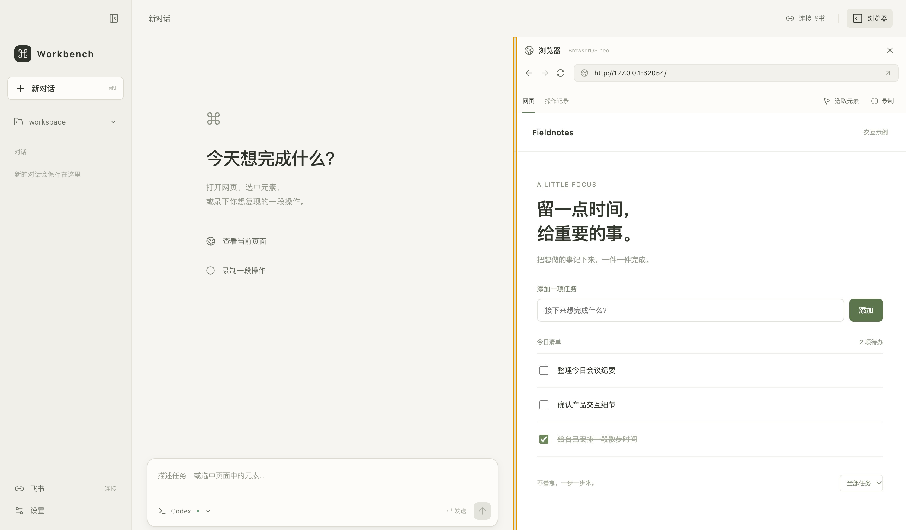

# Agent Workbench

运行在 Mac 上的本地 AI 工作台，界面简称 Workbench。浏览器是 App 同一窗口内的右侧滑出面板，默认收起，可随时展开并拖动边界调整宽度。与本机 Codex 对话，在同一个 BrowserOS neo 页面中浏览、操作和选取元素，主动录制一段操作并交给 Agent 理解；也可通过专用飞书机器人发起任务。



这是可运行的演示项目，仓库保持 `private` / `UNLICENSED`。当前接通的是 **Codex**；Claude Code、OpenCode、Gemini CLI 仅检测安装情况，尚不能在本应用执行任务。

## 启动

需要 macOS、Node.js 22.12 或更高版本、npm，以及可正常登录的 Codex CLI。

在 `agent-workbench` 仓库根目录执行：

```bash
npm ci
npm run setup:browseros
npm run dev
```

`setup:browseros` 使用项目内的 `scripts/setup-browseros.mjs` 获取并校验官方 BrowserOS neo，默认放在仓库相邻的 `../browseros-runtime/BrowserOS neo.app`。脚本不启动浏览器，也不写入 `/Applications`。已有安装可以在「设置与连接 → 浏览器」选择 `BrowserOS neo.app`；应用会尝试发现 `/Applications`、用户 `Applications` 及项目相邻的 `browseros-runtime`。不会把普通 Chrome 当作 BrowserOS neo。

如果尚未安装 Codex，可使用官方 npm 包，然后完成官方登录：

```bash
npm install -g @openai/codex
codex login
codex login status
```

登录完成后，在 Workbench 的「本机 Agent」设置中刷新检测。Workbench 复用该 CLI 的现有登录，不要求把 Codex 密钥粘贴到本应用。安装与登录方式以 [Codex 官方说明](https://github.com/openai/codex#quickstart) 为准；模型调用使用对应账户的配额或计费。

构建后启动和生成本机应用目录：

```bash
npm run build
npm start

# 生成本机 macOS app，采用 ad-hoc 签名，尚未公证
npm run package
```

应用位于 `release/` 下，对应名称为 `Agent Workbench.app`。当前打包配置使用 ad-hoc 签名，没有 Apple Developer ID 签名、公证或自动更新，不代表已完成对外发布。

## 体验一次完整流程

1. 在设置中选择工作目录，确认 Codex 可用。点击窗口右上角「展开浏览器」，在右侧滑出的面板中查看本地示例页，也可在地址栏打开自己的测试页面。
2. 拖动浏览器左边界调整宽度。直接操作侧栏网页，或在聊天框描述任务；Agent 使用的浏览器工具指向同一个页面。直接操作页面会触发人工接管，收起侧栏可回到完整聊天布局。
3. 点击「选取元素」，再点击网页中的目标，将元素上下文带入对话；选取动作本身不触发目标按钮。
4. 点击「录制」，手动完成一段流程，再点击「结束并查看」。记录可导出 JSON。
5. 点击「让 Agent 理解这段操作」，生成目标、步骤、输入参数和待确认预期的分析。此入口要求 Agent 分析已有记录，不重新执行操作。

命令、文件写入或额外权限请求可能需要在 Workbench 桌面界面确认。聊天中的停止按钮可中止当前 Agent 任务。

## 浏览器怎样运行

Electron 负责聊天、设置和同窗口的浏览器侧栏；实际网页由官方 BrowserOS neo 原生引擎以 **DPR 2（Retina）** 渲染。Workbench 通过本机 CDP 将实时页面帧流嵌入右侧面板，并把鼠标、键盘、中文输入和滚动转发到该页面。

neo 作为独立后台进程以 headless 模式运行，**不会打开独立浏览器窗口**。用户始终在 Workbench 的同一窗口内操作网页；这不是把 Electron 自带 Chromium 标成 neo，也不只是静态截图。DPR 2 是页面渲染设置，输入坐标按 CSS 像素映射。

演示使用独立浏览器 profile，并关闭 neo 的 server、updater、extensions 等 sidecars。Workbench 自己提供这一版的浏览器工具；不启动 neo 内置 Agent/MCP 服务，不替换或导入现有 Chrome 配置。退出 Workbench 会结束其管理的浏览器进程。

当前重点是单页面协作。完整多标签管理、复杂跨域 iframe、文件上传下载及所有网站兼容性，尚未作为本 demo 的完整验收范围。

## 飞书

在「设置与连接 → 飞书」点击「创建专用机器人」，用飞书扫码并确认新建。看到“连接已建立”后，向新机器人私聊发送桌面显示的 `绑定 WB-…`，完成操作者配对。

配对后，私聊任务即可在本机运行并回复结果；同一飞书会话在同一工作目录下复用对话。发送 `/cancel`、`停止` 或 `取消` 可请求停止。需要审批时，仍需回到 Mac 确认。

Mac 必须保持开机、联网、Workbench 运行。没有云端代跑；关闭应用或机器睡眠后，不承诺离线消息补发。这里只处理已配对操作者的原始单聊文本。详细步骤和权限见 [飞书连接指南](docs/feishu-setup.md)。

**飞书目前已完成虚拟传输测试，真实扫码、长连接收发和私聊到 Agent 的联调仍待完成。**

## 数据与凭据

- 设置、聊天和操作记录保存在 Electron `userData` 的 `workspace.json`；这些普通工作区数据不是加密数据库。
- 飞书 App Secret、操作者绑定和持久消息 inbox 通过 Electron `safeStorage` 加密后保存；密钥由 macOS 系统密钥存储保护，连接状态不会携带 App Secret。扫码取得的凭据留在主进程；手动输入框在保存成功后清空。加密能力不可用时，不发起机器人创建。
- Codex 登录仍由官方 CLI 管理。浏览器 profile 与普通聊天/录制不属于上述飞书加密范围；演示建议使用测试账号。
- 录制会遮罩识别出的敏感输入字段，但并非全站数据脱敏。检查导出的 JSON、页面文字和截图后再分享；Agent 获取的上下文会进入你选用的模型服务。
- 不要将凭据、浏览器 profile、消息 inbox 或真实用户数据提交到 Git。用 `WORKBENCH_USER_DATA_DIR` 指定自定义数据目录时，应将它放在仓库之外。

## 验证与已知范围

```bash
npm run typecheck
npm test

# 显式运行真实 Codex + BrowserOS neo 集成检查，会产生模型调用
npx tsx tests/live-agent.e2e.ts
```

测试覆盖 CLI 协议、浏览器行为和飞书持久化/配对/去重。真实 BrowserOS neo 与 Codex 的网页操作、录制分析链路已有本地验证；这不代表所有网站均兼容。飞书测试不创建真实应用、不发送真实消息。

操作理解目前产出分析和 JSON 记录，**尚未实现**一键生成完整 Playwright 回归用例、PRD 覆盖率报告或后端状态复原。当前只有供本机使用的 ad-hoc 签名打包，Developer ID 签名、公证、自动更新和对外发布尚未完成。

第三方组件与许可见 [THIRD_PARTY_NOTICES.md](THIRD_PARTY_NOTICES.md)。
