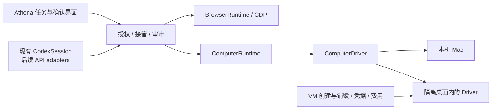

# Athena Computer Use 接入调研

核验日期：2026-10-30。项目基线：Athena 0.2.4 / `083385e7e90c04e04629a202dc1721bb874e7649`。用户已确认：**本机 Mac 与隔离桌面都要，优先本机 Mac。**

本轮检查项目源码、官方文档、开源许可和发行元数据；没有安装驱动、启动桌面控制、修改系统权限、读取凭据或调用模型。下文的架构、阶段和验收标准是建议，不能当作已实现或已实测的能力。

**建议先做“Cua Driver + 现有 CodexSession”的本机单窗口验证，Peekaboo 作为 Mac 专用备选。** 本机链路验收后，沿用同一任务和授权流程接入隔离桌面。现有 BrowserOS/CDP 继续处理网页，不必将准确的 DOM 操作全部改为像素点击。

## 1. Athena 已有基础与真正缺口

当前主执行链为 Electron 主进程 → 本机 Codex app-server → 自定义浏览器工具。已经具备工具注册、图片回传、流式消息、停止、浏览器接管及录制界面；没有桌面窗口枚举、macOS AX 操作、屏幕权限管理或 VM 生命周期。

| 当前模块         | 可以复用                                                             | 需要补充                                                          |
| ---------------- | -------------------------------------------------------------------- | ----------------------------------------------------------------- |
| `CodexSession`   | `dynamicTools` 注册、`item/tool/call` 分发、文字和 `inputImage` 返回 | 桌面工具适配、环境范围；新增工具集应沿用现有 fingerprint 升级流程 |
| `BrowserRuntime` | 精确引用、串行操作、控制权撤销、结果核验的设计经验                   | 原生窗口身份、系统输入接管、锁屏与多显示器；不能直接复用 CSS 坐标 |
| `RequestPanel`   | 明确允许/拒绝的 UI                                                   | 独立的 host 动作审批队列；当前确认路由只响应 Codex 自己的审批请求 |
| 录制与分析       | 时间线、步骤查看、交给 Agent 分析                                    | 桌面窗口/观察标识、截图与 AX 文字的脱敏和留存规则                 |
| 飞书入口         | 现有任务通知和已配对消息处理                                         | 不得因已有配对而自动取得整个本机桌面的控制权                      |

代码依据：[动态工具与图片返回](https://github.com/Dylan-Nihilo/athena/blob/083385e/src/main/agents.ts#L831)、[工具注册](https://github.com/Dylan-Nihilo/athena/blob/083385e/src/main/agents.ts#L641)、[审批路由](https://github.com/Dylan-Nihilo/athena/blob/083385e/src/main/main.ts#L400)、[停止链路](https://github.com/Dylan-Nihilo/athena/blob/083385e/src/main/main.ts#L284)、[当前记录结构](https://github.com/Dylan-Nihilo/athena/blob/083385e/src/shared/types.ts#L172)、[普通 JSON 存储](https://github.com/Dylan-Nihilo/athena/blob/083385e/src/main/store.ts#L49)。

**关键授权缺口：Codex 的 `read-only` 沙箱不自动保护主进程执行的桌面工具。** 源码中自定义工具直接进入 `this.options.callTool(...)`。因此桌面点击、输入、发送和文件操作，必须经过 Athena 自己的范围校验和确认流程，不能仅靠提示词或现有 CLI 的 command/file 审批。

当前配置还主动关闭外部 MCP、apps 和 plugins。本次聊天宿主提供的 Computer Use 工具不会因此自动成为 Athena 的可分发能力，需要接入公开驱动或 SDK。[当前配置](https://github.com/Dylan-Nihilo/athena/blob/083385e/src/main/agents.ts#L235)

## 2. 驱动方案选择

| 方案                   | 已核验状态                                                                                                                   | 适配判断与限制                                                                                          |
| ---------------------- | ---------------------------------------------------------------------------------------------------------------------------- | ------------------------------------------------------------------------------------------------------- |
| **Cua Driver**         | `@trycua/cua-driver` 0.38.0 已发布；原生发行 `cua-driver-rs-v0.38.0`，2026-10-21，GitHub 标为 **Pre-release**；Driver 为 MIT | TypeScript 接口和 Electron 嵌入方式贴合 Athena，也有跨平台路线。作为首选 POC 候选，不能直接宣称生产稳定 |
| **Peekaboo**           | 官方仓库 `openclaw/Peekaboo`；MIT；v4.9.7，2026-10-23，正式发行；macOS 15+                                                   | Mac 专用备选。提供截图、AX、输入、窗口和 MCP；适合复用其持续运行的工具服务                              |
| **自建 Swift helper**  | Apple 提供 AXUIElement、ScreenCaptureKit、CGEvent 等系统 API                                                                 | 控制力最高，但窗口、坐标、IME、焦点、权限和恢复都需维护；第一步没有必要全部重写                         |
| **Cua Sandbox / Lume** | 提供隔离环境的创建与管理路线，和桌面动作驱动是不同职责                                                                       | 适合第二阶段；驱动运行在 guest 内。需要另外处理资源、权限、生命周期、宿主目录共享和许可                 |

版本与许可依据：[Cua Driver 0.38.0 发行](https://github.com/trycua/cua/releases/tag/cua-driver-rs-v0.38.0)、[Cua 许可矩阵](https://github.com/trycua/cua/blob/main/legal/LICENSING.md)、[Peekaboo 仓库](https://github.com/openclaw/Peekaboo)、[Peekaboo 4.9.7](https://github.com/openclaw/Peekaboo/releases/tag/v4.9.7)、[Apple AX](https://developer.apple.com/documentation/applicationservices/axuielement_h)、[ScreenCaptureKit](https://developer.apple.com/documentation/screencapturekit)、[CGEvent](https://developer.apple.com/documentation/coregraphics/cgevent/post%28tap%3A%29)、[Cua SDK](https://cua.ai/docs/cua-sdk)。

不优先选 `browser-use/macOS-use`：官方仓库已归档。nut.js 更适合底层鼠标键盘和图像操作，不能代替完整的窗口语义、授权和任务控制层。[macOS-use](https://github.com/browser-use/macOS-use)、[nut.js](https://github.com/nut-tree/nut.js)

**Cua Driver 的具体接入方式。** 官方提供 `EmbeddedCuaDriverHost`：由权限所属应用直接启动 private host，原生 executable 放在 ASAR 外并签名；npm SDK 不包含该 executable。对 Athena 可评估 `extraResources` 打包、主进程持有 driver、对模型仅暴露受控工具。具体已发布包的导出、原生绑定与 Electron 45.1.0 的兼容性仍是 POC 门槛。Athena 当前真实 bundle ID 是 `app.agent.workbench`，不能在权限归属配置中凭品牌名另造一个 ID。[官方 SDK/嵌入指南](https://cua.ai/docs/cua-driver/guides/use-the-sdk)、[Athena 打包配置](https://github.com/Dylan-Nihilo/athena/blob/083385e/package.json)

**后台能力需要按应用验证。** Cua Driver 官方列出 AppKit、SwiftUI、Electron 等覆盖，但部分后台滚动、拖动、最小化或跨 Space 场景仍会拒绝。可优先尝试后台操作，拒绝后明确请求前台接管，不能无提示地抢占用户焦点。[平台边界](https://cua.ai/docs/cua-driver/concepts/platform-support)

Peekaboo 的快照引用绑定生成者；后续调用应保持同一服务和窗口身份，不应每一步换一个独立进程并猜测引用仍有效。其 MCP 当前支持 stdio，不能把未实现的 HTTP/SSE 当作现成远端控制服务。[Peekaboo MCP](https://github.com/openclaw/Peekaboo/blob/main/docs/MCP.md)

## 3. 推荐架构：模型、动作与环境分开

上图是设计建议，不是当前实现。建议职责如下：

- **模型适配层**处理推理协议和工具结果；先保持当前 CodexSession，后续可增加 Responses、Anthropic 或 Gemini。
- **ComputerRuntime**持有单次任务授权、单输入队列、暂停与停止、观察结果和操作记录。主机/VM 都通过它执行，但授权绑定各自的 `environmentId`。
- **ComputerDriver**只负责观察与有限动作。输入携带目标应用/进程、窗口、观察引用和坐标空间；窗口移动、页面变化或引用失效后重新观察。错误结果应区分“未执行、已执行、结果未知”，结果未知不能自动重放。
- **Provisioner**负责创建/借用/释放环境。模型不能自行提供任意远端地址、VM 凭据或宿主挂载路径；停止任务也不能自动销毁借用的用户资源。
- **桌面面板**显示目标窗口、控制状态和停止入口。复用现有帧展示经验，但不要把浏览器 CSS 像素直接当成 macOS 全局坐标。

宿主模式建议采用 Cua 的 `bounded` 权限上限，再叠加 Athena 逐任务授权。Driver 策略不能被模型工具调用重新配置。[Cua 权限模型](https://cua.ai/docs/cua-driver/guides/permissions)

本机和隔离环境可以共用任务 UI、工具语义和记录格式；一次授权不能同时覆盖两个环境。打开一个桌面镜像面板也不会把真实 Mac 隔离起来。

浏览器与桌面权限也要分开：通用键鼠可以通过浏览器地址栏绕过另一路工具的协议或域名限制。对 BrowserOS、Chrome、Safari 等应用的桌面控制需独立授权，不能因允许浏览网页就一并放开。[驱动权限边界](https://cua.ai/docs/cua-driver/guides/permissions)

## 4. 本机 Mac 的权限与分发

屏幕观察通常需要 Screen Recording，AX 检查和控制需要 Accessibility。全局输入监听、合成输入或 Apple Events 的额外授权，要由实际采用的驱动和系统版本决定；不应默认要求全盘访问。系统授权及锁屏解锁由用户本人完成。

Electron 的 `desktopCapturer` 解决采集；`webContents.sendInputEvent()` 只面向相应网页，不能直接操作 Finder、Excel。`systemPreferences.askForMediaAccess()` 不接受 `screen` 参数，因此授权引导必须按平台支持方式实现。[desktopCapturer](https://www.electronjs.org/docs/latest/api/desktop-capturer)、[webContents](https://www.electronjs.org/docs/latest/api/web-contents)、[systemPreferences](https://www.electronjs.org/docs/latest/api/system-preferences)、[Peekaboo 权限说明](https://github.com/openclaw/Peekaboo/blob/main/docs/permissions.md)

Athena 当前是 ad-hoc 签名且关闭 Hardened Runtime。面向其他用户分发桌面控制能力前，需要验证稳定签名、嵌入 helper 的签名与权限归属，以及公证流程；不能把一次开发机授权当成安装包验收。Electron renderer sandbox 和 macOS App Sandbox 是不同机制，跨 App 控制也不应默认承诺可以按普通 Mac App Store 应用分发。[当前配置](https://github.com/Dylan-Nihilo/athena/blob/083385e/package.json)、[Apple 公证](https://developer.apple.com/documentation/security/resolving-common-notarization-issues)、[Apple App Sandbox](https://developer.apple.com/documentation/security/protecting-user-data-with-app-sandbox)

优先使用 AX 元素动作；无法取得可靠语义时再使用截图与像素坐标。需要绑定应用、窗口和观察结果，并处理多屏原点、Retina、截图缩放和窗口移动。[Apple 截图坐标说明](https://developer.apple.com/videos/play/wwdc2022/10155/?time=1246)

## 5. 隔离桌面的第二阶段

建议先接 Linux 隔离桌面验证环境接口，再按需要接 macOS VM。Linux 更适合浏览器、跨平台办公软件和自动化测试，但不能替代真实 Mac 原生应用的验收。macOS guest 可评估 Apple Silicon 上的 Lume；输入与截图通过 guest 内驱动完成，而非让模型在宿主上猜 VM 窗口坐标。[Lume](https://cua.ai/docs/lume)、[Cua 本地环境](https://cua.ai/docs/cua-cli/quickstart)

默认不共享个人目录、不继承全部登录状态；明确区分临时创建和用户借用的环境，设置资源与运行时限。云端部署还需计入算力、存储、网络和清理成本。本机试验成功后，再考虑无人值守和并发。

**许可必须按组件核验。** Cua Driver、SDK 和 Lume 的许可不能代替 Spaces、viewer、streaming、可选 perception 或操作系统本身的许可；许可矩阵列出多个 FSL-1.1-MIT 目录，可选模型也有各自条款。首轮只选必要 Driver 组件，避免无意带入完整平台。macOS VM 还受 Apple SLA 对硬件、虚拟副本及用途的约束，不能仅凭 Lume 的开源许可推定任意商业托管均获授权。[许可矩阵](https://github.com/trycua/cua/blob/main/legal/LICENSING.md)、[Apple Tahoe SLA](https://www.apple.com/legal/sla/docs/macOSTahoe.pdf)

## 6. 模型接入与成本

| 模型路线                | 当前官方能力                                                                                            | Athena 的选择                                                                           |
| ----------------------- | ------------------------------------------------------------------------------------------------------- | --------------------------------------------------------------------------------------- |
| **Codex app-server**    | 动态工具由客户端执行，可返回图像；官方仍标 experimental                                                 | 第一阶段复用，保持用户现有 CLI 登录与额度路径；不等于已经接入专用 Computer Use API      |
| **OpenAI Responses**    | `ComputerToolset`、`ComputerDriver`、`ResponsesToolRunner`；官方 Node 7.33.0 / Python 3.31.0 有桌面示例 | 后续 API adapter 候选；示例的 Apple Silicon 路线使用 Linux guest，不能当作宿主 Mac 驱动 |
| **Anthropic Messages**  | 当前新版 `computer_toolset_20260801`；动作由应用执行并回传观察                                          | 可接同一运行时，需要新增 API 认证、使用量和确认处理                                     |
| **Gemini Computer Use** | 当前文档支持 browser/mobile/desktop；桌面使用归一化坐标并可能要求确认                                   | 可做候选对照，但需独立坐标及确认语义适配                                                |

依据：[Codex 动态工具](https://learn.chatgpt.com/docs/app-server#dynamic-tool-calls-experimental)、[OpenAI 指南](https://developers.openai.com/api/docs/guides/tools-computer-use)、[Node 桌面示例](https://github.com/openai/openai-node/blob/v7.33.0/examples/computer-desktop/README.md)、[OpenAI driver 契约](https://developers.openai.com/api/docs/guides/tools-computer-use-sdk-drivers#computer-driver-contract)、[Claude 工具](https://platform.claude.com/docs/en/agents-and-tools/tool-use/computer-use-tool)、[Gemini 工具](https://ai.google.dev/gemini-api/docs/computer-use)。

Claude Code 自带的 Computer Use 当前是 macOS 研究预览，需要 Pro/Max 和交互式会话，明确不支持 `-p` 非交互模式。Athena 检测到 Claude CLI 不等于可以直接嵌入这套内置能力。[Claude Code 官方边界](https://code.claude.com/docs/en/computer-use)

现有 Codex 订阅登录与独立 API key 计费是两条路径；复用 CLI 仍会消耗该用户的配额。执行器在本机也不意味着数据不出机：截图及 AX 文字若交给云模型，会进入所配置的推理服务。[Codex 认证](https://learn.chatgpt.com/docs/auth#openai-authentication)

以下仅是 **2026-10-30 的标准 API 单价快照**，单位为美元/100 万 tokens、未缓存输入，不是统一能力排名，也不是每任务报价。所选模型与具体工具模式、账号权限仍需另验。

| 示例模型           |  输入 |  输出 | 备注                                                                                |
| ------------------ | ----: | ----: | ----------------------------------------------------------------------------------- |
| `gpt-6.1-sol`      |    $2 |   $10 | 标准短上下文；其他处理档、缓存与长上下文另计                                        |
| Claude Sonnet 5.5  |    $2 |   $10 | 工具定义、截图和循环上下文都会影响实际输入量                                        |
| `gemini-3.8-flash` | $0.75 | $3.75 | 促销至 2026-12-31；2027-01-01 起为 $1.50 / $7.50；Computer Use 工具不适用 Free tier |

来源：[OpenAI 定价](https://developers.openai.com/api/docs/pricing)、[Claude 定价](https://platform.claude.com/docs/en/about-claude/pricing)、[Gemini 定价](https://ai.google.dev/gemini-api/docs/pricing)。

评估时累计各轮输入、输出、截图与缓存用量，再加环境费用；不能只按“操作十步”估价。应同时记录成功率、重试、人工接管、耗时和单个成功任务成本。优先依赖明确的状态变化等待和必要截图，避免高频全屏截图或为了显得流畅而盲目批量执行。

## 7. 首个 POC 与验收门槛

下面是待实施的验证计划，本轮没有执行：

| 阶段       | 具体闭环                                                 | 进入下一阶段前应证明                                                         |
| ---------- | -------------------------------------------------------- | ---------------------------------------------------------------------------- |
| 只读观察   | 指定窗口截图与 AX 信息                                   | 权限拒绝/撤回有明确状态；窗口身份、截图尺寸、多屏与锁屏判断正确              |
| 本机单窗口 | Calculator 计算并读回；TextEdit 中文输入并保存到测试目录 | 输出由应用状态或文件内容确认；旧引用失效时重新观察；不影响另一个同名窗口     |
| 有限跨应用 | Finder 选择测试文件、Excel 本地测试表格、飞书只起草      | 每个应用有明确范围；实际焦点变化、弹窗、用户接管、停止均有效；不自动发送     |
| 可分发构建 | 安装、授权、升级、撤回权限、卸载                         | Athena/helper 的签名和权限归属稳定；预发布依赖与 Electron 45 的 ABI 实际可用 |
| 隔离环境   | 将同一任务工具接到 guest 内驱动                          | 不默认挂载宿主个人目录或复制账号；创建/借用/释放分明，资源和费用有上限       |

每个动作都要有可检查的后置结果。超时或断连后结果未知时，先观察再决定是否重试；不要用模型的“已完成”或工具“已返回”作为唯一成功证据。[OpenAI 确认与执行边界](https://developers.openai.com/api/docs/guides/tools-computer-use-integration#handle-user-confirmation-and-consent)

飞书远端任务在第一阶段不得自动取得本机桌面权限。可以继续浏览器任务与通知；桌面任务需本机确认，之后才考虑让远端使用预先授权的隔离环境。桌面截图和 AX 内容也不能默认进入现有明文录制或转发到飞书。

**本次建议的下一项工作**：选定 Cua Driver 0.38.0 做受限的本机 POC，与 Peekaboo 4.9.7 在相同测试任务上对照。先验证安装包、权限归属、单窗口中文输入、接管与结果读回，再决定正式依赖。成功率、真实任务成本、完全后台的适用范围以及生产分发兼容性，目前均未在 Athena 中实测。
